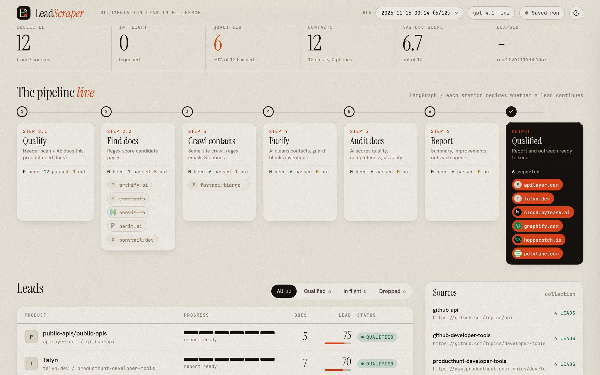
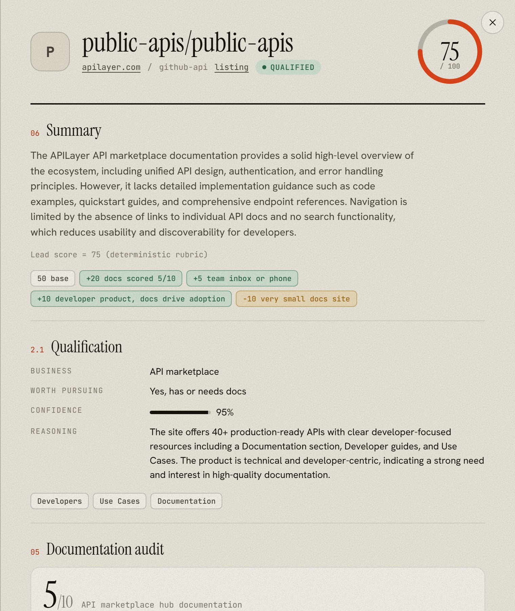
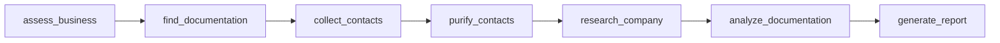

<div align="center">

# LeadScraper

**Find products that have developer docs, audit how good those docs are, find the people behind them, and draft the cold email.**

Python 3.10+ &nbsp;|&nbsp; LangGraph + OpenAI structured output &nbsp;|&nbsp; Playwright &nbsp;|&nbsp; live FastAPI dashboard



</div>

---

## Quick start (2 minutes)

You need **Python 3.10 or newer** ([download](https://www.python.org/downloads/); on Windows tick *Add python.exe to PATH*). Google Chrome is recommended but optional.

| Windows | macOS / Linux |
|---|---|
| Double-click **`start.bat`** | `./start.sh` |
| or `python start.py` | or `python3 start.py` |

That one command does everything, and skips whatever is already done:

1. creates a private virtual environment in `.venv/`
2. installs the Python packages from `requirements.txt` (again only when that file changes)
3. installs Playwright's Chromium for JavaScript-heavy sites
4. creates `.env` and asks for your OpenAI API key (press Enter to skip)
5. copies the sample runs from `samples/` into `output/` so there is something to explore
6. starts the dashboard and opens **http://127.0.0.1:8765** in your browser

Use the same command every time you want to start the app. Stop it with `Ctrl+C`.

> **No API key yet?** Skip the prompt. The dashboard opens with the sample runs, so you can explore every lead, score and email. Add `OPENAI_API_KEY=...` to `.env` later to run your own audits ([get a key](https://platform.openai.com/api-keys)).

---

## Using the dashboard

| To | Do this |
|---|---|
| **Audit one website** | Type a URL (e.g. `svix.com`) in the audit box and press **Audit**. Takes about a minute. |
| **Find and audit leads in bulk** | Tick the sources, set a limit per source, press **Run**. |
| **Open a lead's full dossier** | Click any row in the leads table or any chip on the pipeline. |
| **Look at an earlier run** | Open the **Run** menu. Sample runs are already there. |
| **Stop a run** | Press **Stop**. Leads already in progress finish; nothing new starts. |

Reloading the page mid-run replays it, so nothing is lost. Only one run happens at a time.

Each dossier shows: why the lead qualified (or where it dropped and why), doc scores for quality / completeness / usability with reasons, prioritised improvements, contacts and named decision-makers with copy buttons, the outreach email, how the docs were found, and step timings.

<p align="center"></p>

When Product Hunt shows its Cloudflare check, a visible Chrome window opens and finishes the listing. Leave it alone; it closes by itself.

---

## Command line

Everything the dashboard does is also a command. Pass it to the starter so setup is handled for you (`start.bat <command>` on Windows, `./start.sh <command>` elsewhere), or activate `.venv` and call `python -m leadscraper <command>` directly.

```bash
python start.py lead https://example.com            # audit one website, print the report
python start.py run --limit 10                      # full pipeline, every source
python start.py run --source producthunt-developer-tools --limit 5 --concurrency 2
python start.py collect --source github-api --limit 5   # list leads only, no API cost
python start.py sources                             # configured sources
python start.py graph                               # pipeline as a Mermaid diagram
python start.py serve --port 9000 --no-browser      # dashboard on another port
python start.py setup                               # install / repair only
```

Add `-v` for more logging, `-vv` for debug (before the command: `python start.py -v run`).

---

## What you get

Each run writes to `output/run-YYYYmmdd-HHMMSS/`:

| File | Contents |
|---|---|
| `leads.csv` | One row per lead: status, where it stopped and why, docs URL, contacts, decision-makers, intent signals, scores, outreach subject. Qualified leads first, by lead score. Opens in Excel. |
| `reports/<domain>.md` | Readable report per qualified lead: scores, strengths, weaknesses, improvements, contacts, outreach opener. |
| `leads/<domain>.json` | Full pipeline state, including the evidence behind every decision. |
| `leads.jsonl` | Same rows as the CSV, appended as each lead finishes (survives a crash). |
| `summary.json` | Counts by status and by the step where leads stopped. |

`samples/` holds three real runs (a 12-lead batch, a 9-lead batch and a single-site audit) with every person's name and personal email replaced by fake ones; company inboxes like `support@` are left as found. The starter copies them into `output/` on first start. Delete them from `output/` whenever you like.

`output/` and `audits/` are git-ignored, so your own runs, which contain real contact details, never get committed.

---

## How it works

Leads come from **sources** in `config/sources.yaml` (GitHub topics and Product Hunt out of the box). Each lead then runs through a LangGraph pipeline (`leadscraper/graph.py`):



After every step the lead either continues or stops with a `skip_reason`, so the CSV shows exactly where and why each lead dropped out. The flow is deterministic wherever possible; the model only handles judgement calls, at temperature 0 with strict JSON-schema output, and code guards reject anything it returns that was not on the crawled pages.

| Step | Node | Deterministic part | AI part |
|---|---|---|---|
| 2.1 | `assess_business` | Fetch homepage, pull header/nav links, regex-match doc keywords (docs, api, developers, reference, guide, ...) | `BusinessAssessment`: business type, worth pursuing? |
| 2.2 | `find_documentation` | Candidate URLs from header doc links, then `/docs`, `/api`, `docs.` subdomains, etc. Each page is scored on code blocks, `GET /v1/...` endpoints, `curl`, install commands, doc headings, doc platforms (Mintlify, Docusaurus, GitBook, ...), sidebar. Best score >= `DOCS_SCORE_THRESHOLD` wins. | none |
| 3 | `collect_contacts` | Same-site crawl (contact/about/legal pages first); emails from `mailto:`, text, `[at]` obfuscation and JSON-LD; phones from `tel:` links and contact-page/footer text | none |
| 4 | `purify_contacts` | A guard drops anything the model returns that was not in the crawled input | `ContactInfo`: dedupe, drop invalid / third-party |
| 4.5 | `research_company` | Finds about/team/leadership pages and the changelog. A person is kept only if the name appears verbatim on a fetched page, a signal only if it is on the changelog. The recipient is picked by role: devrel/docs, then product, engineering, leadership. Never drops a lead. | `CompanyResearch`: named people with roles, up to 3 recent docs-relevant changelog entries |
| 5 | `analyze_documentation` | Samples up to `DOCS_MAX_PAGES` doc pages from the sidebar; metrics (code blocks, languages, search, words) | `DocAnalysis`: quality, completeness, usability 0-10 with reasons |
| 6 | `generate_report` | Lead score 0-100 from a fixed rubric (doc score gap, contact quality, developer-product fit, docs size, +5 named decision-maker, +10 docs-relevant change in the last 90 days), with the breakdown saved | `LeadReport`: summary, prioritised improvements, outreach opener addressed to the recipient and opening on the intent signal |

People only come from the company's own site. Someone named only on LinkedIn will not be found.

---

## Adding a lead source

Most listing sites work with the generic `browser_listing` adapter. Add an entry to `config/sources.yaml`:

```yaml
  - name: some-directory-devtools
    adapter: browser_listing
    url: https://some-directory.example/category/devtools
    options:
      item_link_pattern: '^/tools/[a-z0-9-]+$'       # links to item detail pages
      website_selector: 'a.visit-site'               # external link on the detail page
      # omit website_selector if the listing links straight to product sites
```

Test it without spending API credits: `python start.py collect --source some-directory-devtools --limit 3`. It then appears in the dashboard's source list.

Another GitHub topic only needs a new `github_topic` entry with the topic URL. For a site that needs different logic (an API, an unusual page shape), add a class in `leadscraper/sources/`, decorate it with `@register("adapter_name")`, and import it in `leadscraper/sources/__init__.py`. Every `browser_listing` option is documented in `leadscraper/sources/browser_listing.py`.

---

## Configuration

All settings live in `.env` (created by the starter; every option is listed in `.env.example`). The ones you are most likely to change:

| Variable | Default | What it does |
|---|---|---|
| `OPENAI_API_KEY` | (none) | Required to run audits |
| `OPENAI_MODEL` | `gpt-4.1-mini` | Model for every AI step |
| `OPENAI_BASE_URL` | OpenAI | Any OpenAI-compatible endpoint |
| `GITHUB_TOKEN` | (none) | Raises the GitHub search limit from 10 to 30 requests/minute |
| `CONCURRENCY` | `3` | Leads processed in parallel |
| `CONTACT_MAX_PAGES` | `30` | Pages crawled per site looking for contacts |
| `DOCS_SCORE_THRESHOLD` | `6` | How doc-like a page must look to count as documentation |
| `BROWSER_CHANNEL` | `chrome` | Use installed Chrome; set empty for bundled Chromium |

---

## Troubleshooting

| Problem | Fix |
|---|---|
| `python` is not recognised | Install Python 3.10+ and tick *Add python.exe to PATH*, or use `py start.py` on Windows. |
| Run / Audit buttons are greyed out | No API key. Add `OPENAI_API_KEY=...` to `.env` and restart. |
| Setup stopped halfway | Fix the error it printed and run the starter again; finished steps are skipped. Delete `.venv/` to start completely fresh. |
| Port 8765 is in use | `python start.py serve --port 9000` |
| Product Hunt returns nothing | Install Google Chrome. Its Cloudflare check blocks headless browsers; the app falls back to a visible Chrome window. |
| `Executable doesn't exist` from Playwright | Delete `.venv/.playwright-chromium` and run the starter again. |

---

## Project layout

```
start.py / start.bat / start.sh   one-command setup and launch
leadscraper/
  cli.py                          commands (python -m leadscraper --help)
  graph.py                        the LangGraph pipeline and lead score
  llm.py, schemas.py              prompts and structured-output models
  docs.py, crawler.py, research.py, extract.py, fetcher.py, browser.py
  sources/                        lead source adapters (github_topic, browser_listing)
  web/                            dashboard: FastAPI server + static UI
config/sources.yaml               where leads come from
samples/                          anonymised sample runs (copied to output/ on first start)
output/                           your run results (git-ignored)
showcase/                         scripts that capture screenshots/videos and build a slide deck
docs/requriement.md               the original brief
docs/images/                      README screenshots
```

The showcase scripts (`showcase/capture.py`, `build.py`, `audit_sites.py`) need extra packages (`pillow`, `python-pptx`) and ffmpeg; see `showcase/README.md`. The app itself does not.
